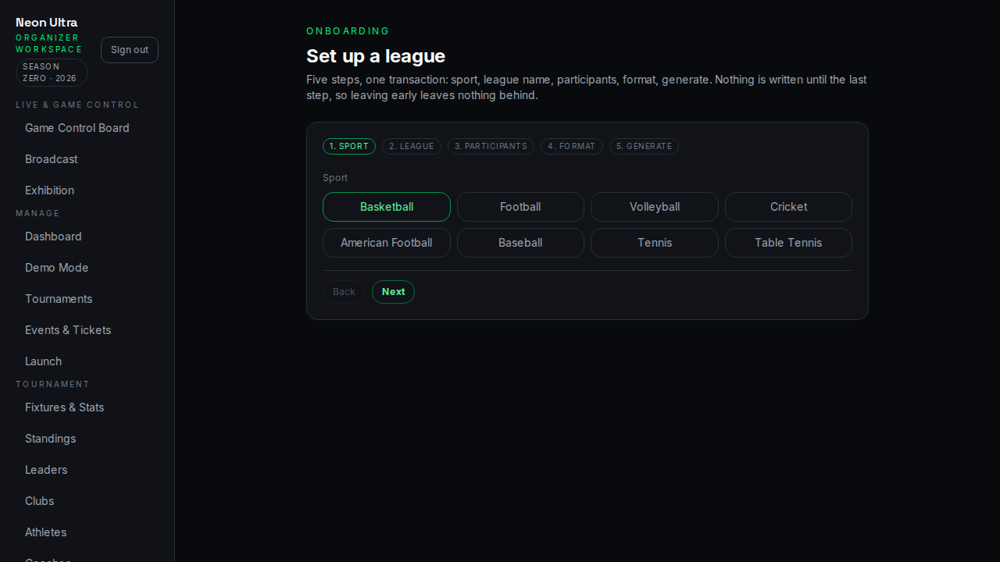
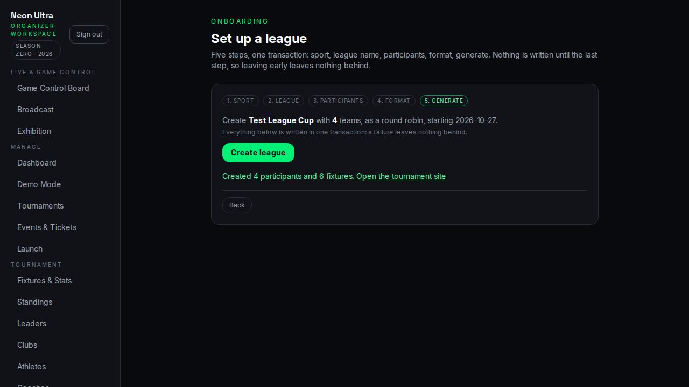
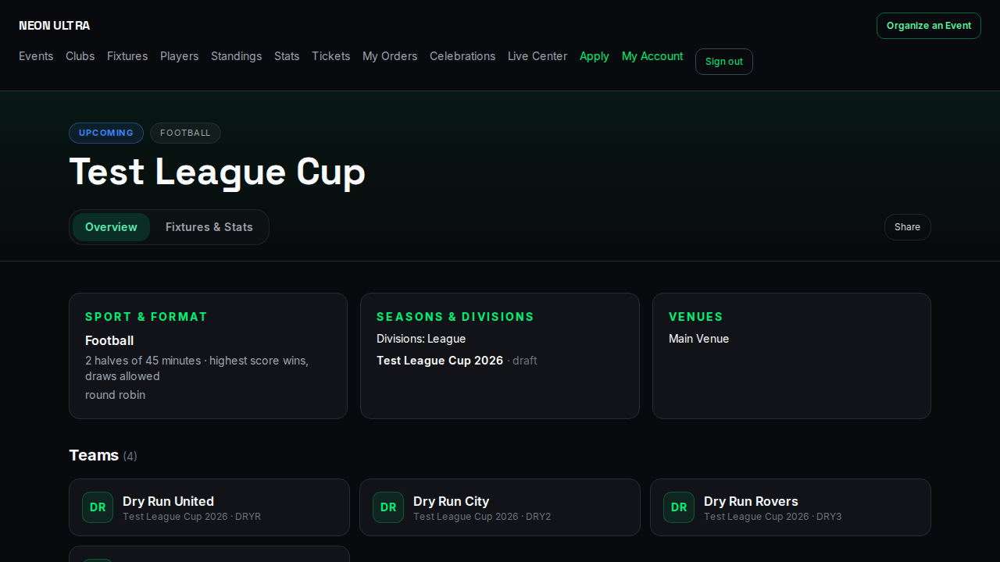

# Customer onboarding — from signup to a live league

Written for the person who has just been handed UltraLeagueOS: a league operator, an LBCL Season 2 administrator, or a new
partner. Every route below was checked against the deployed staging build on 2026-10-27 (`200` for a public page, `307`
to `/login` for a page that requires a session).

> There is one route this guide deliberately does NOT mention: `/stats`. It does not exist (`404`); the analytics screens
> are `/admin/data-quality` for league-wide numbers and `/games/<fixtureId>/stats` for one match.

---

## 1. Create your account and your league

1. Go to **`/signup`** (`/signup?role=organizer` carries the intent). Sign up with Google or email and password.
2. A brand-new account with no role lands on **`/no-league`** — that page exists on purpose: it tells you your account
   is real but belongs to no league yet, and links to your profile.
3. An existing operator grants you a role in their organization, or you create your own league with the wizard below.

**Creating your own league** needs a `SUPER_ADMIN` to create the organization once (this is the platform-operator step,
not something a self-signup can do), after which the organization's own administrators run everything else. The
organization's public-id prefixes are allocated automatically, so a second organization on the same database works.

## 2. Set up the competition — `/admin/setup-wizard`

Five steps, one transaction — nothing is written until the last one:

| Step | What you enter |
| --- | --- |
| 1. Sport | Basketball, Football, Tennis, Volleyball, Cricket, Baseball, Table Tennis, American Football, Flag Race |
| 2. League | Competition name (optionally a new organization's name and slug, platform admins only) |
| 3. Participants | Teams (one per line) for a team sport, entrants for an individual sport |
| 4. Format | Round robin (once or home-and-away) or knockout, and the first match day |
| 5. Generate | One button: organization (if new), competition, division, season, clubs, and the fixtures |

A knockout pads to a power of two and skips byes; a team sport creates the clubs for you. If anything fails, nothing is
created — a half-built league is worse than none.

### Dry run: what actually happens when a new organizer follows this guide

This guide was executed end to end on 2026-10-27 (streak v22) as a platform admin creating a brand-new organization,
**Test League**, with four teams and a round robin, then scoring one match. The screenshots below are from that run.

What the run produced: **4 teams · 6 fixtures** (a four-team single round robin is 3+2+1), the tournament at
`/t/test-league/test-league-cup-mvqxrc9x`, and one match scored **2-1** to a final with standings updated
(Dry Run United P1 W1 3pts · Dry Run City P1 L1).

**Friction the run exposed, all of it now fixed or written down here:**

1. **Creating a new organization through the wizard did not work.** Step 5 hung with an empty alert: the league was being
   built inside the caller's tenant context, and `Competition`/`Division`/`Season`/`Club` are all row-level-secured, so
   every insert for the new league was refused. Fixed: the organization is created first, then the league is built inside
   its own context. **If you are on an older build, create the organization before using the wizard.**
2. **The competition slug is not clean.** `/t/test-league/test-league-cup-mvqxrc9x` - a short suffix keeps slugs unique
   across seasons. Do not guess the URL; use the "Open the tournament site" link the wizard prints.
3. **The sidebar says "Neon Ultra / Season Zero · 2026" on pages that do not yet know their organization** (the wizard is
   one). The league dashboard shows your own league name; the rest of the shell is being swept. Cosmetic, but do not
   mistake it for a different account - the page content is yours.
4. **`/stats` does not exist** - the analytics screens are `/admin/data-quality` (league-wide) and
   `/games/<fixtureId>/stats` (one match).
5. **A new organization starts on the FREE plan** (one competition, no API keys, no webhooks). `/settings/billing` shows
   the limits and the upgrade path; a platform admin can raise the plan at `/admin/organizations`.

## 3. Add players — three ways, pick one

| Route | For | Notes |
| --- | --- | --- |
| **Public registration** `/register/<organizationSlug>/competitions/<competitionSlug>/player` | the normal path | Anyone with the link can apply. Creates an **Athlete** and a **PLAYER application** in `SUBMITTED` — registration is not approval. The applicant sees a receipt with a reference and is told whether a confirmation email was sent. |
| **CSV / spreadsheet import** inside `/applications` | migrating an existing roster | The importer understands the league's own column layout; it stages rows for review rather than writing players directly. |
| **Manual entry** `/applications` | one-offs, corrections | Same review path as everything else. |

Approving an application provisions the player (user, athlete, roster) and is audited. `/applications/export` gives you
CSV of any category (`401` without a session — it is an authenticated download, not a public one).

## 4. Score a match

- **Live console**: `/operations/matchday` (today's fixtures) → `/games/<fixtureId>/live`. Sport-aware controls (Goal,
  +2/+3, sets, periods), a clock where the sport has one, undo, and finalisation. Finalising writes the result, decides
  the winner, and recalculates standings.
- **After the fact**: `/applications`-style import for box scores, and `/games/<fixtureId>/stats` for reconciliation and
  reports (`box-score`, `play-by-play`, `shot-chart`).
- **Broadcast**: the console has **Copy OBS URL** and **Embed code** buttons; the overlay lives at
  `/broadcast/overlay/<organizationSlug>/<fixtureId>` and is transparent.

## 5. AI vision — upload a video, confirm events

1. Upload the game video against the fixture (`/vision` lists analysis runs).
2. The vision worker runs YOLO on it and writes observations with timestamps and bounding boxes.
3. Review them at `/vision/games/<fixtureId>`: confirm or reject each observation.
4. **Confirming cuts a 10-second highlight** around that timestamp, uploads it to object storage, and links it to the
   fixture — it appears under "Highlights" on the match centre and the league dashboard.

## 6. Analytics

- **`/admin/data-quality`** — final games, result-source and record-origin breakdowns, the box-score verification rate,
  highlight count, and two integrity checks (player points vs the team's score, period sums vs the final). Missing data
  is reported separately from wrong data.
- **`/dashboard`** and `/admin/<organizationSlug>/dashboard` — live fixtures, pending applications, recent highlights,
  ticket revenue and plan.
- **Athlete passports** — each player's public career view, rendered on the athlete's public page.

## 7. If you are a sportsbook — the API feed

1. **`/api-docs`** is the public reference: endpoints, auth, error codes, and the webhook event types.
2. Keys are issued per organization at **`/settings/api-keys`** (PRO plan and above; a FREE organization has no keys by
   design). The raw key is shown once — only its hash is stored.
3. Subscribe a webhook in the same settings area for `SCORE_CHANGED`, `WIN_PROBABILITY_UPDATED`, `CARD_ISSUED`,
   `GAME_ENDED` and `VISION_EVENT_CONFIRMED`. Deliveries are HMAC-signed (`x-ultra-signature`), at-least-once, with a
   stable delivery id to de-duplicate on.
4. Everything is also available pull-style: `/api/v1/live`, `/api/v1/games/<publicId>/snapshot`,
   `/api/v1/seasons/<publicId>/standings`, `/api/v1/exports/tournament/<competitionId>`.

## 8. Billing

`/settings/billing` shows the plan, every limit with its usage bar, and the upgrade path. Two things to know:

- Limits are enforced where a resource is created (API keys, competitions, webhooks), so the plan applies to the API, the
  wizard and the webhook console alike.
- **Checkout runs through Bachs.** A deployment with no `BACHS_KEY` shows a TEST MODE banner and a mock checkout; a
  deployment with a **live** key outside production shows a red warning, because that combination can charge a real card.

## 9. First-week checklist

- [ ] Competition created in `/admin/setup-wizard`, fixtures visible at `/t/<organizationSlug>/<competitionSlug>`
- [ ] At least one player registered and approved in `/applications`
- [ ] One match scored end to end in the live console, standings updated
- [ ] One video analysed in `/vision`, one observation confirmed, one highlight visible on the match centre
- [ ] `/admin/data-quality` shows the game and no integrity failures
- [ ] API key issued (if a partner needs one) and a webhook delivered
- [ ] Plan confirmed in `/settings/billing`
